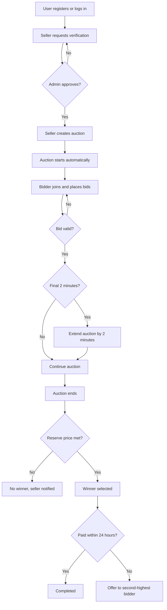
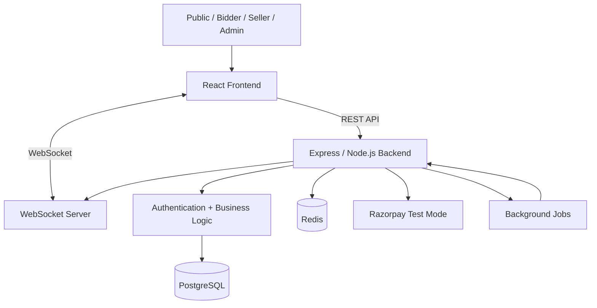
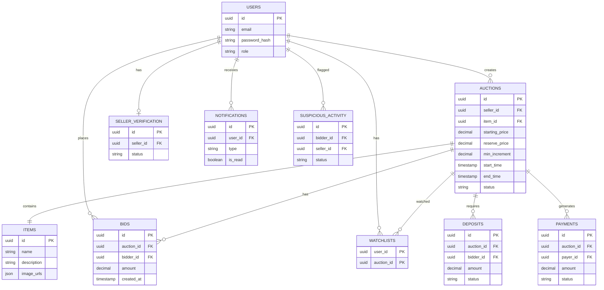

# Live Auction Platform — Product Requirements Document (PRD)

**Version:** 1.0  
**Project Type:** Full-Stack Real-Time Online Auction Platform  
**Status:** Proposed Product Requirements

---

## 1. Product Overview

Live Auction Platform is an online auction system where many users bid on the same item in real time.

- **Sellers** list items by creating auctions with images, a starting price, a reserve price, a minimum bid increment, and start and end times.
- **Bidders** browse auctions, join a live auction, and place bids. Every connected bidder sees the new highest bid instantly over WebSockets.
- **Admins** manage users, verify sellers, monitor auctions, and review suspicious bidding.

Real-time updates and concurrency handling are essential: when many people bid at the same moment, the platform must accept exactly one valid bid, keep the highest bid consistent for everyone, and keep the auction fair.

---

## 2. Problem Statement

Traditional and basic online auction systems commonly face these problems:

- No real-time bid updates, so users must refresh the page.
- Multiple users bidding simultaneously.
- Race conditions when concurrent bids are processed.
- Last-second bidding (sniping) that leaves other bidders no time to respond.
- Manual auction start and end management.
- Difficulty managing deposits and winner payments.
- No proper seller verification or suspicious activity monitoring.

**How this platform solves them:**

- WebSocket-based live bidding pushes updates instantly.
- Redis locking and database transactions make concurrent bids atomic.
- Anti-sniping extends the auction when a valid bid arrives in the final 2 minutes.
- Scheduled background jobs start and end auctions automatically.
- Refundable deposits and a 24-hour winner checkout manage payments.
- Admin seller verification and suspicious bidding alerts protect the platform.

---

## 3. Product Goals

1. Provide a real-time auction experience.
2. Allow sellers to create and manage auctions.
3. Allow bidders to place secure and valid bids.
4. Handle simultaneous bids correctly.
5. Automatically manage auction start and end times.
6. Provide secure payment and deposit workflows.
7. Provide notifications and auction history.
8. Maintain a secure, scalable and maintainable system.

---

## 4. Target Users and Roles

The main authenticated roles are **Bidder**, **Seller** and **Admin**. Guests can browse public auctions but must log in before bidding.

| Role | Responsibilities |
|---|---|
| Guest / Public Visitor | Browse public auctions; view auction details; access registration and login |
| Bidder | Participate in auctions; place bids; use proxy bidding; maintain watchlist; receive notifications; view bid history; complete payment if they win |
| Seller | Create auctions; upload item images; set starting price, reserve price and minimum bid increment; set start and end time; view auction results |
| Admin | Manage users; verify sellers; monitor auctions; review suspicious bidding; manage platform activity |

---

## 5. Core Features

### 5.1 Authentication and User Profile

- Register.
- Login and logout.
- JWT authentication.
- Secure password hashing.
- Role-based authorization.
- User profile.
- Seller verification status.

### 5.2 Seller Verification

- Seller requests verification.
- Admin reviews the seller.
- Admin approves or rejects the seller.
- Only verified sellers can create auctions.

### 5.3 Auction Creation

- Create auction.
- Upload item images.
- Product name and description.
- Starting price.
- Reserve price.
- Minimum bid increment.
- Start date/time.
- End date/time.

### 5.4 Auction Lifecycle

`UPCOMING → ACTIVE → ENDED`

- Automatic start at the scheduled start time.
- Automatic end at the scheduled (or extended) end time.
- Scheduled background jobs drive status changes.
- Auction status is managed and stored by the backend.

After `ENDED`, the result is one of: winner selected, no winner (reserve price not met), or second-highest bidder offered the item.

### 5.5 Live Bidding

- WebSocket-based real-time bidding.
- Current highest bid is shown.
- Minimum next bid is shown.
- Instant bid updates.
- Connected bidders receive updates without page refresh.

### 5.6 Concurrent Bid Validation

When two or more bids arrive at nearly the same time:

- The backend validates each bid.
- A Redis lock and/or database transaction makes the check-and-write atomic.
- Only a valid bid state is committed; the other bid is rejected.
- Race conditions are prevented.

### 5.7 Anti-Sniping

A valid bid placed during the final 2 minutes extends the auction by 2 minutes.

- The updated end time is stored and broadcast.
- The real-time timer updates for all bidders.
- Multiple valid extensions are allowed.

### 5.8 Proxy Bidding

- Bidder sets a maximum amount.
- The system automatically bids on behalf of the bidder.
- The system bids in minimum required increments.
- Proxy bidding continues until the maximum amount is reached.

### 5.9 Refundable Deposit

- High-value auctions may require a refundable deposit.
- Razorpay Test Mode is used.
- The deposit must be completed before eligible bidding.
- Deposit and payment status is tracked.

### 5.10 Reserve Price

- Seller can define a reserve price.
- If the highest bid does not reach the reserve price, the auction ends without a winner.
- The seller receives the auction result.

### 5.11 Winner Checkout

- The highest eligible bidder becomes the winner.
- The winner must pay the remaining balance within 24 hours.
- If the winner fails to pay, the item may be offered to the second-highest bidder.

### 5.12 Watchlist and Notifications

- Add or remove an auction from the watchlist.
- Outbid notifications.
- Auction ending notifications.
- Winner notifications.
- Payment notifications.

### 5.13 Bid History

- Bidder.
- Bid amount.
- Timestamp.
- Auction.
- Chronological bid history.

### 5.14 Suspicious Bidding

- Detect suspicious or repeated bidding patterns, such as one user repeatedly bidding against the same seller.
- Generate alerts.
- Allow admins to review suspicious activity.

### 5.15 Admin Management

- User management.
- Seller verification.
- Auction monitoring.
- Suspicious activity monitoring.
- Platform activity management.

---

## 6. Technology Stack

| Layer | Technology | Purpose |
|---|---|---|
| Frontend | React + TypeScript | User interface |
| Build Tool | Vite | Frontend development and build |
| Styling | Tailwind CSS / CSS | Responsive UI |
| Routing | React Router | Frontend navigation |
| Backend | Node.js + TypeScript | Server-side application |
| Framework | Express.js | REST API |
| Database | PostgreSQL | Permanent application data |
| Real-time | WebSocket / Socket.IO | Live bidding |
| Cache/Lock | Redis | Bid locking, caching and auction state |
| Authentication | JWT | Authentication and authorization |
| Payment | Razorpay Test Mode | Deposits and payments |
| Background Jobs | Node.js scheduler / suitable job queue | Auction start/end |
| Containerization | Docker | Local infrastructure |
| Testing | k6 + API/Unit tests | Testing and load testing |
| Version Control | Git + GitHub | Source-code management |
| CI/CD | GitHub Actions | Automated validation and deployment |

**Architecture: Modular Monolith**

The backend is a single deployable application organized into modules: authentication, users, auctions, bidding, payments, notifications and administration. Each module owns its routes, services and data access, which keeps the code maintainable without the overhead of microservices.

---

## 7. Important Product Rules

1. Email must be unique.
2. Passwords must never be stored in plain text.
3. Only verified sellers can create auctions.
4. Only authenticated bidders can place bids.
5. A bid must satisfy the minimum increment.
6. A bid cannot be placed after an auction ends.
7. Concurrent bids must be handled atomically.
8. A bid in the final 2 minutes extends the auction by 2 minutes.
9. The reserve price must be reached for a winner.
10. The winner must complete payment within 24 hours.
11. If the winner fails to pay, the second-highest bidder may become eligible.
12. Duplicate bid requests must not create duplicate valid bids.
13. Client-side bid values must never be trusted without backend validation.
14. Payment responses must be verified on the server.
15. Role-based access must be enforced on the backend.

---

## 8. Non-Functional Requirements

### Performance

- Fast API responses.
- Real-time bid updates.
- Efficient database queries.
- Pagination for lists.

### Security

- JWT authentication.
- Password hashing.
- Input validation.
- Role-based authorization.
- Rate limiting.
- Secure environment variables.
- Payment verification.

### Reliability

- Correct auction timing.
- No inconsistent highest-bid state.
- Proper error handling.
- Recovery from WebSocket disconnection.

### Scalability

- Redis support.
- Efficient database queries.
- Support for multiple concurrent bidders.

### Usability

- Clean UI.
- Responsive design.
- Clear auction status.
- Clear bid feedback.
- Loading, error and empty states.

### Maintainability

- Modular frontend and backend.
- Reusable components.
- Consistent API responses.
- Tests for critical business rules.

---

## 9. Main Application Pages

**Public**

1. Landing Page
2. Auction Listing
3. Auction Details
4. Login
5. Registration

**Bidder**

6. Bidder Dashboard
7. Live Auction
8. My Bids
9. Watchlist
10. Notifications
11. Payment / Checkout
12. Profile

**Seller**

13. Seller Dashboard
14. Create Auction
15. My Auctions
16. Auction Details
17. Auction Results
18. Profile

**Admin**

19. Admin Dashboard
20. User Management
21. Seller Verification
22. Auction Management
23. Suspicious Activity
24. Reports / Monitoring

---

## 10. High-Level User Workflow

1. User registers or logs in.
2. Bidder browses available auctions.
3. Seller registers and requests verification.
4. Admin verifies the seller.
5. Seller creates an auction.
6. Auction becomes active automatically.
7. Bidder joins the auction.
8. Bidder places bids through WebSocket-based real-time bidding.
9. System validates bids.
10. Anti-sniping extends the auction when applicable.
11. Auction ends.
12. Reserve price is checked.
13. Winner is selected.
14. Winner completes payment within 24 hours.
15. If payment fails or time expires, the second-highest bidder may become eligible.



---

## 11. Out of Scope

The current MVP does not include:

- Voice or video calls.
- Live streaming.
- Social media features.
- Complex AI recommendation systems.
- Cryptocurrency payments.
- Payment providers other than the selected test payment gateway (Razorpay Test Mode).
- Advanced analytics unless required.
- Mobile application.

These can be considered as future enhancements.

---

## 12. Success Criteria

The platform is considered functionally successful when:

- Users can register and log in.
- Roles work correctly.
- Sellers can be verified.
- Verified sellers can create auctions.
- Auctions automatically start and end.
- Multiple bidders can bid in real time.
- Concurrent bids are handled correctly.
- Anti-sniping works.
- Proxy bidding works.
- Deposits work in Razorpay Test Mode.
- Reserve price logic works.
- Winner checkout works.
- Second-highest bidder flow works.
- Watchlist and notifications work.
- Bid history is stored correctly.
- Suspicious bidding alerts work.
- The application passes the required tests.
- The application can be deployed successfully.

---

## 13. Future Improvements

- Mobile application.
- Advanced analytics.
- AI-based fraud detection.
- Email/SMS notifications.
- Multiple payment gateways.
- Advanced recommendation system.
- Advanced seller analytics.

---

## 14. System Architecture



---

## 15. Database Overview

Main entities: Users, Auctions, Items, Bids, Deposits, Payments, Notifications, Watchlists, Seller Verification, Suspicious Activity.



---

## 16. API Overview

| Method | Endpoint | Purpose | Role |
|---|---|---|---|
| POST | `/api/auth/register` | Register a user | Public |
| POST | `/api/auth/login` | Login and receive JWT | Public |
| GET | `/api/auth/me` | Get current user | Authenticated |
| GET | `/api/auctions` | List auctions | Public |
| GET | `/api/auctions/:id` | Get auction details | Public |
| POST | `/api/auctions` | Create auction | Verified Seller |
| PATCH | `/api/auctions/:id` | Update auction (before it starts) | Seller (owner) |
| DELETE | `/api/auctions/:id` | Delete or cancel auction | Seller (owner), Admin |
| POST | `/api/auctions/:id/bids` | Place a bid | Bidder |
| GET | `/api/auctions/:id/bids` | Get bid history | Public |
| POST | `/api/sellers/verify` | Request seller verification | Seller |
| GET | `/api/sellers/status` | Get verification status | Seller |
| POST | `/api/deposits` | Create and confirm refundable deposit | Bidder |
| POST | `/api/payments` | Pay winning balance | Winner |
| GET | `/api/payments/:id` | Get payment details | Payer, Admin |
| GET | `/api/notifications` | List notifications | Authenticated |
| PATCH | `/api/notifications/:id/read` | Mark notification as read | Authenticated |

**WebSocket events**

- `auction:join`
- `auction:leave`
- `bid:placed`
- `bid:updated`
- `auction:extended`
- `auction:ended`
- `outbid`

---

## 17. Team Roles and Ownership

Each team member must have clearly assigned ownership and responsibility for their modules.

| Role | Responsibilities |
|---|---|
| Team Leader — [Name] | Project coordination, architecture decisions, pull request review, PRD and delivery tracking |
| Frontend Developer — [Name] | React pages for public, bidder, seller and admin; live auction UI; forms and states |
| Backend Developer — [Name] | Authentication, auctions, seller verification, bidding logic, payments, notifications APIs |
| Real-Time/Database Developer — [Name] | WebSocket events, Redis locking, schema and migrations, background jobs |
| QA/Testing — [Name] | API, WebSocket and concurrent bid tests, k6 load tests, bug reports |
| DevOps/Documentation — [Name] | Docker, GitHub Actions, deployment, README and documentation |

---

## 18. GitHub and Development Workflow

**Repository:** `live-auction-platform`

```text
live-auction-platform/
├── frontend/
├── backend/
├── tests/
├── docs/
├── .github/
│   └── workflows/
├── docker-compose.yml
├── AGENTS.md
├── README.md
└── .gitignore
```

- `frontend/` — React + TypeScript application.
- `backend/` — Node.js + Express + TypeScript application, organized by module.
- `tests/` — API, concurrency and k6 load test scripts.
- `docs/` — PRD and project documentation.
- `.github/workflows/` — GitHub Actions pipelines.
- `docker-compose.yml` — PostgreSQL and Redis for local development.
- `AGENTS.md` — project rules for contributors.

**Branches**

- `main` — stable, deployable code.
- `develop` — integration branch.
- `feature/*` — one branch per feature, for example `feature/live-bidding`.

**Rules**

- No direct push to `main`.
- Pull requests are required.
- Code review is required.
- CI must pass before merge.

---

## 19. AGENTS.md Project Rules

- Use TypeScript.
- Follow the existing folder structure.
- Do not commit secrets.
- Use environment variables.
- Validate API input.
- Backend must enforce authorization.
- Bid operations must be atomic.
- Do not trust client-side bid values.
- Write tests for critical business logic.
- Run lint and tests before opening a PR.
- No direct push to `main`.
- Keep commits meaningful.
- Update documentation when necessary.

---

## 20. Testing and Security

### Testing

- Unit Testing
- Integration Testing
- API Testing
- WebSocket Testing
- Concurrent Bid Testing
- Load Testing
- Security Testing
- Regression Testing

Load testing uses **k6** with these scenarios:

| Scenario | Concurrent Bidders |
|---|---|
| Load test 1 | 100 |
| Load test 2 | 500 |
| Load test 3 | 1000 |

### Security

- Password hashing.
- JWT.
- Role-based access control (RBAC).
- Input validation.
- Rate limiting.
- CORS.
- Secure headers.
- Payment verification on the server.
- WebSocket authentication.
- Secrets stored in environment variables.
- No sensitive information in logs.

---

## 21. Definition of Done

A feature is considered **DONE** only when:

- [ ] Requirement implemented.
- [ ] UI completed.
- [ ] API completed.
- [ ] Validation implemented.
- [ ] Error handling implemented.
- [ ] Security checked.
- [ ] Tests written.
- [ ] Tests passed.
- [ ] Code reviewed.
- [ ] CI passed.
- [ ] Documentation updated.
- [ ] No critical bugs remain.
- [ ] Feature demonstrated successfully.

---

## 22. 15-Day Development Plan

| Day | Feature / Deliverable |
|---|---|
| 1 | Repo with TypeScript; schema for users, auctions, items, bids, deposits and payments; Redis in Docker |
| 2 | Login with roles (bidder, seller, admin); seller verification by admin |
| 3 | Seller creates auctions: images, starting price, reserve price, minimum bid increment, start and end time |
| 4 | Auctions start and end automatically using scheduled background jobs |
| 5 | Live bidding over WebSockets: every bidder sees the new highest bid instantly |
| 6 | Bid validation under load: when two bids arrive at the same moment, exactly one wins using Redis lock or database transaction |
| 7 | Anti-sniping: a bid in the last 2 minutes extends the auction by 2 minutes |
| 8 | Proxy bidding: bidder sets a maximum and system bids for them in minimum increments |
| 9 | Refundable deposit using Razorpay Test Mode before bidding on high-value items |
| 10 | Reserve price not met: auction ends with no winner and seller is notified |
| 11 | Winner checkout: winner pays balance within 24 hours or item goes to second-highest bidder |
| 12 | Watchlist and outbid notifications |
| 13 | Bid history with timestamps and suspicious bidding alerts |
| 14 | Load test with many bidders using k6; tests; README |
| 15 | Deployment; demo and individual viva |

---

## 23. Glossary

| Term | Definition |
|---|---|
| Auction | A time-limited sale where the highest valid bid wins |
| Bid | An offer of money for an item in an auction |
| Bidder | An authenticated user who places bids |
| Seller | A verified user who lists items for auction |
| Reserve Price | The minimum price the seller accepts; if not reached, there is no winner |
| Starting Price | The opening price of an auction |
| Minimum Bid Increment | The smallest amount by which a new bid must exceed the current bid |
| Proxy Bidding | The bidder sets a maximum and the system bids for them in minimum increments up to that maximum |
| Anti-Sniping | A rule that extends the auction by 2 minutes when a valid bid arrives in the final 2 minutes |
| Deposit | A refundable amount paid before bidding on high-value items |
| Winner | The highest eligible bidder when the reserve price is met |
| WebSocket | A persistent two-way connection used to push live updates |
| Redis | An in-memory data store used for locking, caching and auction state |
| Concurrent Bid | Bids that reach the server at nearly the same time |
| Second-Highest Bidder | The bidder with the next highest bid, who may be offered the item if the winner does not pay |
