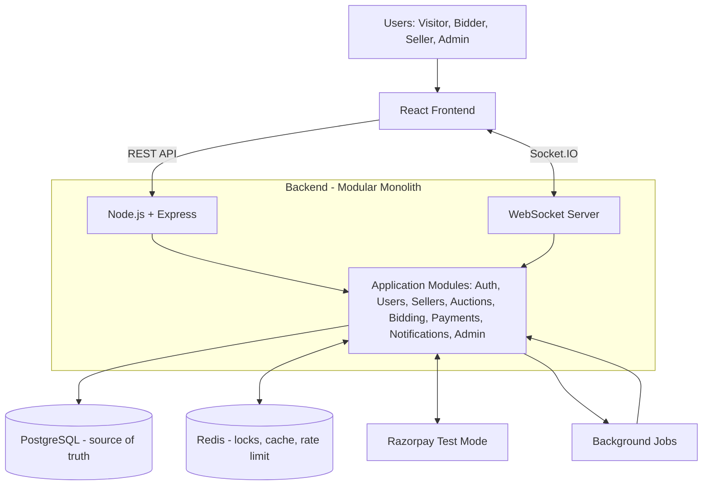
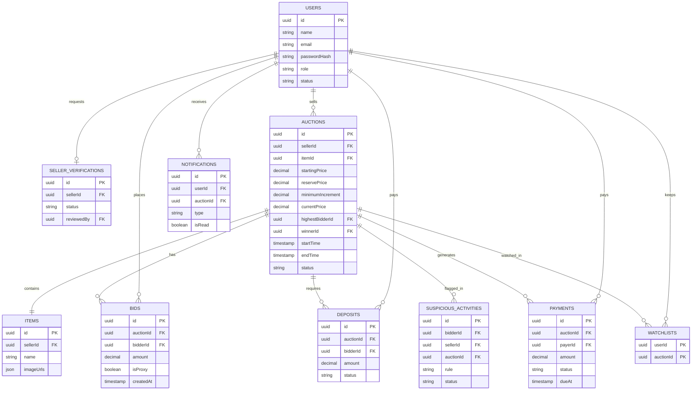
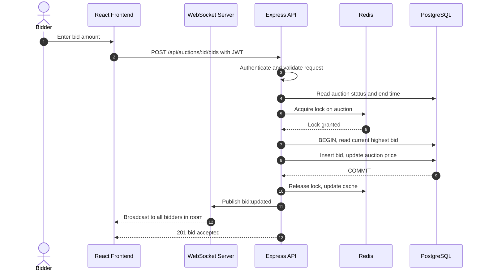
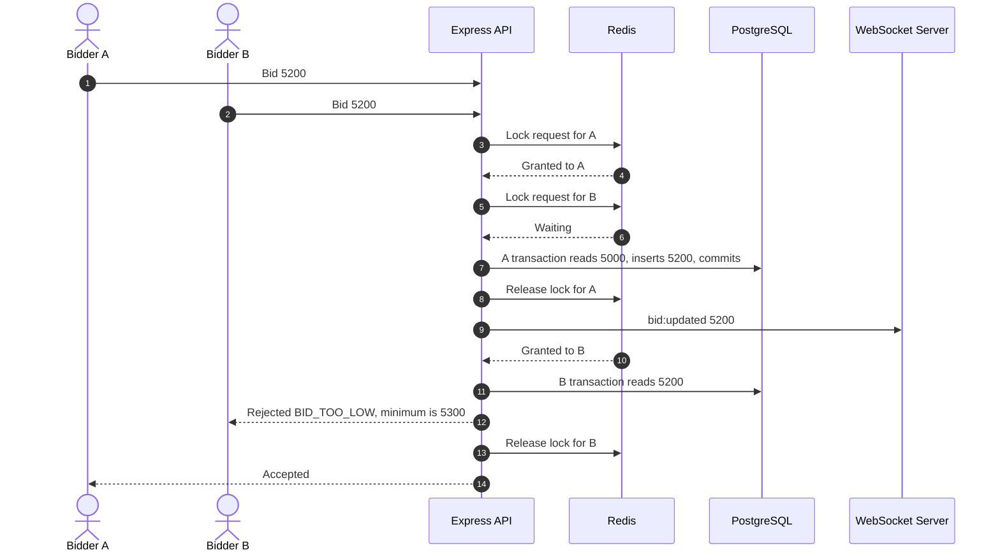
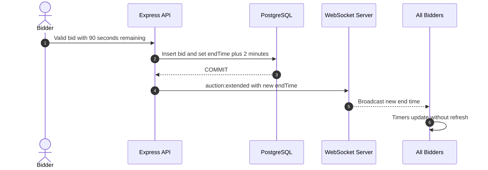
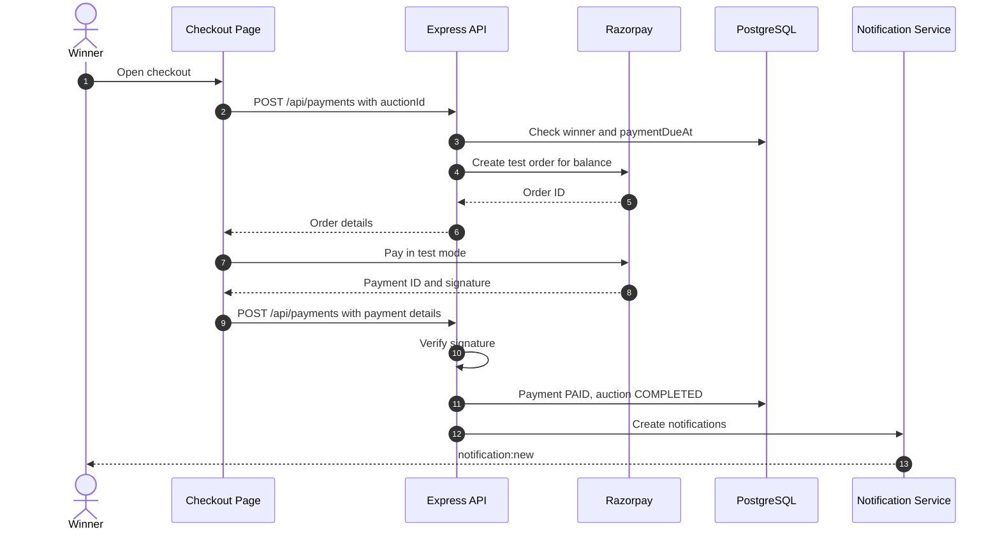
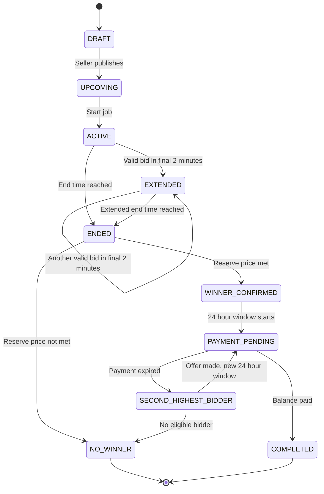
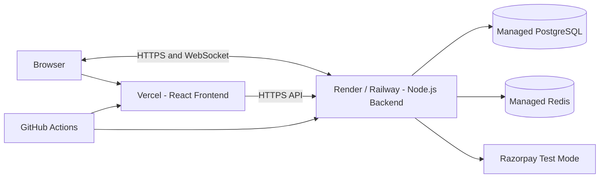
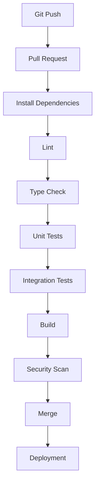

# Live Auction Platform — Software Requirements Specification (SRS)

**Version:** 1.0  
**Project Type:** Full-Stack Real-Time Online Auction Platform  
**Project Duration:** 15 Days  
**Status:** Proposed Software Requirements

---

## Table of Contents

1. Introduction
2. Technology Stack
3. Functional Requirements
4. System Architecture
5. Database Design
6. ER Diagram
7. Technical Workflows
8. Sequence Diagrams
9. Auction State Management
10. Real-Time Communication
11. Redis and Background Processing
12. API Documentation
13. API Error Handling
14. Security Requirements
15. UI/UX Requirements
16. Non-Functional Requirements
17. Testing
18. 15-Day Development Plan
19. Deployment
20. GitHub and CI/CD
21. AGENTS.md Project Rules
22. Definition of Done
23. Assumptions and Constraints
24. Out of Scope
25. Future Scope
26. Quality Verification
27. Appendix — Detailed API Examples

---

## 1. Introduction

### 1.1 Purpose

This SRS defines the functional and technical requirements of the **Live Auction Platform**. It is intended for developers, testers, project reviewers and team members, and serves as the single technical reference for implementation, testing and viva.

### 1.2 Problem Statement

A multi-user auction system must solve these technical problems:

- **Real-time bid synchronization:** every connected user must see the same highest bid without refreshing.
- **Concurrent bids:** many bids can arrive at the same moment for the same auction.
- **Race conditions:** a read-then-write bid check can accept two bids that should not both be valid.
- **Auction timing:** auctions must start and end exactly on schedule, using server time.
- **Last-second bidding:** bids at the very end leave other bidders no time to react.
- **Payment and deposit management:** deposits, refunds, winner payments and payment deadlines must be tracked reliably.
- **Seller verification:** only trusted sellers should list items.
- **Suspicious activity:** repeated bidding patterns must be detected and reviewed.

### 1.3 Scope

**Included in the MVP**

- Registration, login, JWT authentication and role-based authorization (BIDDER, SELLER, ADMIN).
- Seller verification by admin.
- Auction creation and management with images, starting price, reserve price, minimum increment, start and end time.
- Automatic auction start and end through scheduled background jobs.
- Real-time bidding over Socket.IO with atomic concurrent bid handling.
- Anti-sniping, proxy bidding, refundable deposits (Razorpay Test Mode) and reserve price handling.
- Winner selection, winner checkout within 24 hours and second-highest bidder flow.
- Watchlist, in-app notifications, bid history and suspicious bidding alerts.
- Admin monitoring, automated testing, k6 load testing and deployment.

**Excluded from the MVP:** see Section 24 (Out of Scope) and Section 25 (Future Scope).

### 1.4 Target Users

| User | Description |
|---|---|
| Public Visitor | Unauthenticated user; can browse auctions and view details; must register or log in to bid |
| Bidder | Authenticated user (role `BIDDER`); joins auctions, bids, uses proxy bidding, keeps a watchlist, pays deposits and winning balances |
| Seller | Authenticated user (role `SELLER`); requests verification; once verified, creates and manages auctions |
| Admin | Authenticated user (role `ADMIN`); manages users, verifies sellers, monitors auctions and reviews suspicious activity |

### 1.5 Key Terms

| Term | Meaning |
|---|---|
| Auction | A time-limited sale of one item in which the highest valid bid wins |
| Bid | An offer of an amount for an item in an active auction |
| Bidder | A user who places bids |
| Seller | A verified user who lists items for auction |
| Reserve Price | The minimum price the seller accepts; if the highest bid is below it there is no winner |
| Starting Price | The minimum opening price of an auction |
| Minimum Bid Increment | The smallest amount by which a new bid must exceed the current highest bid |
| Proxy Bidding | The bidder sets a maximum and the system bids for them in minimum increments up to that maximum |
| Anti-Sniping | A rule that extends the auction by 2 minutes when a valid bid arrives in the final 2 minutes |
| Deposit | A refundable amount paid through Razorpay Test Mode before bidding on a high-value auction |
| Winner | The highest eligible bidder when the auction ends and the reserve price is met |
| WebSocket | A persistent two-way connection used to push live updates (implemented with Socket.IO) |
| Redis | An in-memory store used as supporting infrastructure for locks, caching and rate limiting; it is not the source of truth |
| Concurrent Bid | Bids for the same auction that reach the server at nearly the same time |
| Race Condition | A defect where the result depends on the timing of concurrent operations |

---

## 2. Technology Stack

| Layer | Technology | Purpose |
|---|---|---|
| Frontend | React | Component-based user interface |
| Frontend | TypeScript | Type-safe frontend code |
| Frontend | Vite | Frontend development server and build |
| Frontend | Tailwind CSS | Responsive styling |
| Frontend | React Router | Client-side routing |
| Backend | Node.js | Server runtime |
| Backend | Express.js | REST API framework |
| Backend | TypeScript | Type-safe backend code |
| Database | PostgreSQL | Source of truth for all permanent data |
| ORM | Prisma | Schema, migrations and typed database access |
| Validation | Zod | Request and message validation |
| Real-Time | Socket.IO / WebSocket | Live bidding and notifications |
| Cache / Locking | Redis | Bid locks, temporary auction state, caching, rate limiting |
| Authentication | JWT | Stateless authentication |
| Authentication | bcrypt | Password hashing |
| Payments | Razorpay Test Mode | Deposits and winner payments |
| Background Processing | Node.js scheduled jobs / suitable job queue | Auction start/end, payment expiry, notifications |
| Testing | Vitest / Jest | Unit and integration tests |
| Testing | Supertest | API testing |
| Testing | Playwright (if required) | End-to-end UI tests |
| Testing | k6 | Load testing |
| Infrastructure | Docker | Local PostgreSQL and Redis |
| Version Control | Git + GitHub | Source management |
| CI/CD | GitHub Actions | Automated validation and deployment |
| Deployment | Vercel (frontend); Render / Railway (backend); managed PostgreSQL and Redis | Hosting |

**Architecture: Modular Monolith.** The backend is one deployable application divided into modules, each with its own routes, service layer and data access:

| Module | Responsibility |
|---|---|
| Authentication | Register, login, logout, token issuing and verification |
| Users | Profile management |
| Sellers | Verification requests and status |
| Auctions | Auction creation, management and lifecycle |
| Items | Item details and images |
| Bidding | Bid validation, locking, proxy bidding, anti-sniping, bid history |
| Payments | Deposits, winner payments, refunds, Razorpay verification |
| Notifications | Notification creation and delivery |
| Watchlist | Watchlist management |
| Suspicious Activity | Pattern detection and alerts |
| Admin | User management, seller decisions, monitoring |

---

## 3. Functional Requirements

### 3.1 Requirement Table

| ID | Feature | Requirement |
|---|---|---|
| FR-01 | Registration and Login | Users shall register with a unique email and a password that meets validation rules. Passwords shall be hashed with bcrypt. The system shall issue a JWT on login and shall support logout. |
| FR-02 | Role-Based Authorization | The system shall support the roles BIDDER, SELLER and ADMIN. The backend shall enforce role authorization on every protected endpoint and socket event. |
| FR-03 | Seller Verification | A seller shall submit a verification request. An admin shall approve or reject it. Only sellers with status VERIFIED shall create auctions. |
| FR-04 | User Profile | Authenticated users shall view and update their own profile. |
| FR-05 | Auction Creation | A verified seller shall create an auction with item name, description, images, starting price, reserve price, minimum bid increment, start time and end time. |
| FR-06 | Auction Management | A seller shall view their auctions and statuses. Auction states are DRAFT → UPCOMING → ACTIVE → ENDED (with the additional states in Section 9). A seller shall not modify an auction once it is ACTIVE. |
| FR-07 | Automatic Start and End | The system shall start and end auctions automatically at the configured timestamps using scheduled background jobs. |
| FR-08 | Live Bidding | Bidders shall place bids during ACTIVE (or EXTENDED) auctions. Accepted bids shall be broadcast to all connected clients through Socket.IO. |
| FR-09 | Bid Validation | The backend shall validate that the auction is ACTIVE or EXTENDED, the user is authenticated and eligible, the bid exceeds the current valid bid, the minimum increment is satisfied, and the deposit requirement is met where applicable. |
| FR-10 | Concurrent Bid Handling | When two or more bids arrive simultaneously the backend shall prevent race conditions using a Redis lock and a PostgreSQL transaction. Only a valid bid state shall be committed and the highest bid shall remain consistent. |
| FR-11 | Anti-Sniping | If a valid bid is placed when 2 minutes or less remain, the end time shall be extended by 2 minutes, the new end time shall be broadcast, and clients shall update their timers without refresh. |
| FR-12 | Proxy Bidding | A bidder may set a maximum amount. The system shall place incremental bids on their behalf until the maximum is reached or another bidder exceeds it. |
| FR-13 | Refundable Deposit | For high-value auctions the system shall require a deposit before bidding, using Razorpay Test Mode. It shall support deposit creation, payment verification, deposit status tracking and refund handling. |
| FR-14 | Reserve Price | If the highest bid is below the reserve price at auction end, the auction shall end with no winner and the seller shall be notified. |
| FR-15 | Winner Selection | When an auction ends and the reserve price is met, the highest eligible bidder shall be recorded as the winner. |
| FR-16 | Winner Checkout | The winner shall pay the remaining balance (final price minus paid deposit) within 24 hours of winner confirmation. |
| FR-17 | Second-Highest Bidder | If the winner does not pay within 24 hours, the system shall offer the item to the second-highest eligible bidder, who receives a new 24-hour payment window. |
| FR-18 | Watchlist | A bidder shall add, remove and view watchlist auctions. |
| FR-19 | Notifications | The system shall create notifications for outbid, winning, auction ending, auction extended and payment events, and deliver them in real time to connected users. |
| FR-20 | Bid History | The system shall store bid ID, auction ID, bidder ID, amount and timestamp for every accepted bid and expose them in chronological order. |
| FR-21 | Suspicious Bidding | The system shall detect defined suspicious patterns (Section 7, W15) and create alerts for admin review. |
| FR-22 | Admin Management | Admins shall manage users, verify sellers, monitor auctions and review suspicious activity. |

### 3.2 Requirement Traceability

| FR | API | Workflow | Tables |
|---|---|---|---|
| FR-01 | `/api/auth/*` | W1 | Users |
| FR-02 | All protected endpoints | W1, W5 | Users |
| FR-03 | `/api/sellers/verification`, `/api/admin/sellers/:id/verify` | W2 | SellerVerifications |
| FR-04 | `/api/users/me` | W1 | Users |
| FR-05 | `POST /api/auctions` | W3 | Auctions, Items |
| FR-06 | `/api/auctions` | W3 | Auctions |
| FR-07 | Background jobs | W4, W10 | Auctions |
| FR-08 | `POST /api/auctions/:id/bids`, `bid:place` | W5 | Bids, Auctions |
| FR-09 | `POST /api/auctions/:id/bids` | W5 | Bids, Deposits |
| FR-10 | `POST /api/auctions/:id/bids` | W6 | Bids, Auctions |
| FR-11 | `POST /api/auctions/:id/bids` | W7 | Auctions |
| FR-12 | `POST /api/auctions/:id/bids` (`maxAmount`) | W8 | ProxyBids, Bids |
| FR-13 | `/api/auctions/:id/deposit` | W9 | Deposits |
| FR-14 | Background job | W10 | Auctions, Notifications |
| FR-15 | Background job | W10 | Auctions |
| FR-16 | `/api/payments` | W11 | Payments |
| FR-17 | Background job | W12 | Payments, Auctions |
| FR-18 | `/api/watchlist/*` | W13 | Watchlists |
| FR-19 | `/api/notifications` | W14 | Notifications |
| FR-20 | `GET /api/auctions/:id/bids` | W5 | Bids |
| FR-21 | `/api/admin/suspicious-activity` | W15 | SuspiciousActivities |
| FR-22 | `/api/admin/*` | W2, W15 | Users, SellerVerifications |

---

## 4. System Architecture

The backend is a **modular monolith**: one Node.js + Express process hosts the REST API, the Socket.IO server and the scheduled jobs. PostgreSQL stores all permanent data. Redis supports locking, caching and rate limiting.



| Layer | Responsibility |
|---|---|
| React Frontend | Pages, forms, live auction view, timers, WebSocket client |
| REST API | Authentication, CRUD operations, bid submission, payments |
| WebSocket Server | Auction rooms, broadcasting updates, user notifications |
| Application Modules | Business rules, validation, authorization, transactions |
| PostgreSQL | Permanent, consistent storage of users, auctions, bids, payments |
| Redis | Per-auction bid locks, cached current state, rate limit counters, Socket.IO coordination |
| Razorpay | Test-mode payment orders and signature verification |
| Background Jobs | Auction start/end, payment expiry, notification and suspicious activity processing |

---

## 5. Database Design

PostgreSQL is accessed through Prisma. Primary keys are UUIDs. Money is stored as `NUMERIC(12,2)` in INR. Timestamps are `TIMESTAMPTZ` in UTC.

| Table | Columns | Primary Key | Foreign Keys | Constraints / Notes |
|---|---|---|---|---|
| Users | id UUID; name VARCHAR(100); email VARCHAR(255); passwordHash VARCHAR(255); role ENUM(BIDDER, SELLER, ADMIN); status ENUM(ACTIVE, SUSPENDED); createdAt; updatedAt | id | none | `email` UNIQUE; passwords stored only as bcrypt hash |
| SellerVerifications | id UUID; sellerId UUID; details JSONB; status ENUM(PENDING, VERIFIED, REJECTED); reviewedBy UUID NULL; reason TEXT NULL; createdAt; reviewedAt NULL | id | sellerId → Users.id; reviewedBy → Users.id | One active record per seller (`sellerId` UNIQUE) |
| Items | id UUID; sellerId UUID; name VARCHAR(200); description TEXT; imageUrls JSONB; createdAt | id | sellerId → Users.id | At least one image URL required by validation |
| Auctions | id UUID; sellerId UUID; itemId UUID; startingPrice; reservePrice; minimumIncrement; currentPrice; highestBidderId UUID NULL; startTime; endTime; extensionCount INT; depositRequired BOOLEAN; depositAmount NULL; status ENUM (Section 9); winnerId UUID NULL; finalPrice NULL; paymentDueAt NULL; offerRound INT; createdAt; updatedAt | id | sellerId, highestBidderId, winnerId → Users.id; itemId → Items.id | `itemId` UNIQUE; CHECK reservePrice ≥ startingPrice; CHECK endTime > startTime; CHECK minimumIncrement > 0 |
| Bids | id UUID; auctionId UUID; bidderId UUID; amount NUMERIC; isProxy BOOLEAN; idempotencyKey VARCHAR(100) NULL; createdAt | id | auctionId → Auctions.id; bidderId → Users.id | UNIQUE (auctionId, amount); UNIQUE (auctionId, bidderId, idempotencyKey) |
| ProxyBids (supporting) | id UUID; auctionId UUID; bidderId UUID; maxAmount NUMERIC; createdAt; updatedAt | id | auctionId → Auctions.id; bidderId → Users.id | UNIQUE (auctionId, bidderId); stores the maximum for FR-12 |
| Deposits | id UUID; auctionId UUID; bidderId UUID; amount NUMERIC; razorpayOrderId; razorpayPaymentId NULL; status ENUM(CREATED, PAID, REFUNDED, ADJUSTED, FAILED); createdAt; updatedAt | id | auctionId → Auctions.id; bidderId → Users.id | UNIQUE (auctionId, bidderId); UNIQUE razorpayOrderId |
| Payments | id UUID; auctionId UUID; payerId UUID; amount NUMERIC; razorpayOrderId; razorpayPaymentId NULL; status ENUM(PENDING, PAID, FAILED, EXPIRED); dueAt; paidAt NULL; createdAt | id | auctionId → Auctions.id; payerId → Users.id | UNIQUE razorpayOrderId; one PAID payment per auction |
| Watchlists | userId UUID; auctionId UUID; createdAt | (userId, auctionId) | userId → Users.id; auctionId → Auctions.id | Composite primary key prevents duplicates |
| Notifications | id UUID; userId UUID; auctionId UUID NULL; type VARCHAR(50); message TEXT; isRead BOOLEAN; createdAt | id | userId → Users.id; auctionId → Auctions.id | Types: OUTBID, WON, AUCTION_ENDING, AUCTION_EXTENDED, PAYMENT, NO_WINNER |
| SuspiciousActivities | id UUID; bidderId UUID; sellerId UUID; auctionId UUID NULL; rule VARCHAR(100); bidCount INT; status ENUM(OPEN, REVIEWED, DISMISSED); reviewedBy NULL; createdAt | id | bidderId, sellerId, reviewedBy → Users.id; auctionId → Auctions.id | Created by the detection job |

**Indexes**

- Users: `email` (unique).
- Auctions: `(status, endTime)` for jobs; `(sellerId)`; `(status, startTime)` for listings.
- Bids: `(auctionId, createdAt)` for history; unique `(auctionId, amount)`.
- Notifications: `(userId, isRead, createdAt)`.
- Payments: `(auctionId)`, `(status, dueAt)` for expiry job.
- SuspiciousActivities: `(status, createdAt)`.

---

## 6. ER Diagram



Relationship notes: USERS → SELLER_VERIFICATIONS is 1:0..1; the seller relationship to AUCTIONS uses `sellerId`; WATCHLISTS resolves the many-to-many relationship between users and auctions. The supporting `ProxyBids` table (Section 5) links USERS and AUCTIONS the same way as `BIDS` and is omitted from the diagram for readability.

---

## 7. Technical Workflows

### W1 — User Registration

| Item | Detail |
|---|---|
| Trigger | `POST /api/auth/register` |
| Preconditions | Email not registered |
| Main flow | Validate with Zod → hash password with bcrypt → create user with role BIDDER or SELLER → issue JWT |
| Database changes | Insert into Users |
| Redis changes | Rate limit counter for the endpoint |
| WebSocket events | None |
| Success response | 201 with user and token |
| Failure cases | 400 invalid input; 409 email exists; 429 rate limit |

### W2 — Seller Verification

| Item | Detail |
|---|---|
| Trigger | Seller `POST /api/sellers/verification`; admin `PATCH /api/admin/sellers/:id/verify` |
| Preconditions | Seller authenticated; admin authenticated |
| Main flow | Seller submits details → status PENDING → admin approves or rejects with reason → seller notified |
| Database changes | Insert/update SellerVerifications; insert Notifications |
| Redis changes | None |
| WebSocket events | `notification:new` to the seller |
| Success response | 201 (request) / 200 (decision) |
| Failure cases | 409 already pending or verified; 403 not admin; 404 unknown seller |

### W3 — Auction Creation

| Item | Detail |
|---|---|
| Trigger | `POST /api/auctions` |
| Preconditions | Seller status VERIFIED |
| Main flow | Validate prices and times (reserve ≥ starting price, end > start, start in the future, increment > 0) → insert item and auction as UPCOMING (or DRAFT) → schedule start and end jobs |
| Database changes | Insert Items, Auctions |
| Redis changes | Cache auction summary |
| WebSocket events | None |
| Success response | 201 with auction |
| Failure cases | 400 invalid; 403 seller not verified |

### W4 — Auction Start

| Item | Detail |
|---|---|
| Trigger | Scheduled job at `startTime` |
| Preconditions | Auction status UPCOMING |
| Main flow | Job locks the auction row → sets ACTIVE → caches state → notifies watchers |
| Database changes | Update Auctions.status; insert Notifications for watchlist users |
| Redis changes | Set auction state cache |
| WebSocket events | `bid:updated` (initial state) to room; `notification:new` |
| Success response | Not applicable (internal) |
| Failure cases | Job failure is retried; a startup sweep activates overdue UPCOMING auctions |

### W5 — Live Bid Placement

| Item | Detail |
|---|---|
| Trigger | `POST /api/auctions/:id/bids` or socket `bid:place` |
| Preconditions | Authenticated BIDDER; auction ACTIVE or EXTENDED |
| Main flow | Authenticate → validate payload → acquire Redis lock → in a transaction read auction, validate (status, end time, amount, increment, deposit) → insert Bid → update currentPrice and highestBidderId → commit → release lock → broadcast |
| Database changes | Insert Bids; update Auctions |
| Redis changes | Lock `lock:auction:{id}`; update cached state |
| WebSocket events | `bid:updated`; `outbid` to the previous leader |
| Success response | 201 with bid and current state |
| Failure cases | 401; 403; 402/403 `DEPOSIT_REQUIRED`; 409 `AUCTION_NOT_ACTIVE`, `BID_TOO_LOW`, `DUPLICATE_BID`; 422 `MIN_INCREMENT_NOT_MET`; 503 lock unavailable |

### W6 — Concurrent Bidding

| Item | Detail |
|---|---|
| Trigger | Two or more bids for the same auction at nearly the same time |
| Preconditions | As W5 |
| Main flow | Requests contend for the per-auction lock → first holder commits → second acquires the lock, re-reads the committed highest bid inside its transaction and fails validation if no longer higher |
| Database changes | Exactly one Bid per amount (unique `(auctionId, amount)` is the final guard) |
| Redis changes | Lock acquire/release with expiry (a crashed request cannot hold it forever) |
| WebSocket events | One `bid:updated` per accepted bid |
| Success response | 201 for the winning request |
| Failure cases | 409 `BID_TOO_LOW` for the losing request; 503 if the lock cannot be obtained in time |

### W7 — Anti-Sniping

| Item | Detail |
|---|---|
| Trigger | Valid bid accepted inside W5 |
| Preconditions | `endTime − now ≤ 2 minutes` |
| Main flow | Within the same transaction set `endTime = endTime + 2 minutes`, increment `extensionCount`, set status EXTENDED → reschedule end job after commit |
| Database changes | Update Auctions.endTime, extensionCount, status |
| Redis changes | Update cached endTime |
| WebSocket events | `auction:extended` with new end time; notifications to bidders and watchers |
| Success response | Bid response includes new `endTime` |
| Failure cases | Bid invalid → no extension. Each later qualifying bid extends again |

### W8 — Proxy Bidding

| Item | Detail |
|---|---|
| Trigger | Bid request containing `maxAmount` |
| Preconditions | As W5; `maxAmount` ≥ minimum acceptable bid |
| Main flow | Store maximum → place bid at the minimum acceptable amount → when another bid arrives, if a stored maximum is higher, the system places `min(maximum, newBid + minimumIncrement)` as an automatic bid inside the same lock; if the new bid exceeds every other maximum the new bidder leads and the proxy bidder is outbid |
| Database changes | Upsert ProxyBids; insert Bids with `isProxy = true` |
| Redis changes | Same lock as W5 |
| WebSocket events | `bid:updated`; `outbid` |
| Success response | 201 with resulting current price |
| Failure cases | 400 maximum too low; as W5 |

### W9 — Deposit Payment

| Item | Detail |
|---|---|
| Trigger | `POST /api/auctions/:id/deposit` |
| Preconditions | Auction has `depositRequired = true`; user is BIDDER |
| Main flow | Step 1: create Razorpay test order → store Deposit CREATED. Step 2: client pays and sends order ID, payment ID and signature → server verifies signature → Deposit PAID |
| Database changes | Insert/update Deposits; insert Notifications |
| Redis changes | None |
| WebSocket events | `notification:new` |
| Success response | 201 order / 200 verified deposit |
| Failure cases | 400 invalid signature (`PAYMENT_FAILED`); 409 already paid |

### W10 — Auction Completion

| Item | Detail |
|---|---|
| Trigger | End job at current `endTime` |
| Preconditions | Auction ACTIVE or EXTENDED |
| Main flow | Re-read `endTime` (if extended, reschedule and stop) → set ENDED → if `currentPrice ≥ reservePrice` set WINNER_CONFIRMED, `winnerId`, `finalPrice`, `paymentDueAt = now + 24 hours`, create Payment PENDING, status PAYMENT_PENDING; else set NO_WINNER and refund deposits |
| Database changes | Update Auctions, insert Payments or update Deposits, insert Notifications |
| Redis changes | Remove auction lock and state cache |
| WebSocket events | `auction:ended`; `notification:new` (winner, seller, bidders) |
| Success response | Internal |
| Failure cases | Job retry is idempotent (status check before change) |

### W11 — Winner Checkout

| Item | Detail |
|---|---|
| Trigger | `POST /api/payments` |
| Preconditions | Caller is `winnerId`; status PAYMENT_PENDING; now ≤ `paymentDueAt` |
| Main flow | Create Razorpay order for `finalPrice − paid deposit` → client pays → server verifies signature → Payment PAID → auction COMPLETED → deposit ADJUSTED |
| Database changes | Update Payments, Auctions, Deposits; insert Notifications |
| Redis changes | None |
| WebSocket events | `notification:new` to winner and seller |
| Success response | 201 order / 200 payment confirmed |
| Failure cases | 403 not winner; 410 payment window expired; 400 `PAYMENT_FAILED`; duplicate payment ignored by order ID |

### W12 — Second-Highest Bidder

| Item | Detail |
|---|---|
| Trigger | Payment expiry job when `paymentDueAt` has passed |
| Preconditions | Payment still PENDING |
| Main flow | Mark payment EXPIRED → find the highest bid from a different eligible bidder (deposit paid where required) → if found: set `winnerId`, `finalPrice` to that bid, `offerRound + 1`, new `paymentDueAt = now + 24 hours`, new Payment PENDING → if none: set NO_WINNER |
| Database changes | Update Payments, Auctions; insert Notifications |
| Redis changes | None |
| WebSocket events | `notification:new` |
| Success response | Internal |
| Failure cases | No eligible second bidder → NO_WINNER and seller notified |

### W13 — Watchlist

| Item | Detail |
|---|---|
| Trigger | `POST/DELETE /api/watchlist/:auctionId`, `GET /api/watchlist` |
| Preconditions | Authenticated BIDDER; auction exists |
| Main flow | Insert or delete the (userId, auctionId) row; list returns auctions with current price and end time |
| Database changes | Insert/delete Watchlists |
| Redis changes | None |
| WebSocket events | None |
| Success response | 201 / 200 |
| Failure cases | 404 auction not found; 409 already in watchlist |

### W14 — Notifications

| Item | Detail |
|---|---|
| Trigger | Outbid, auction ending, extension, win, payment, no winner |
| Preconditions | Event occurred |
| Main flow | Service inserts Notification → emits `notification:new` to the user's room if connected → user reads via `GET /api/notifications` and marks read |
| Database changes | Insert/update Notifications |
| Redis changes | Socket.IO adapter coordination if multiple instances |
| WebSocket events | `notification:new` |
| Success response | 200 |
| Failure cases | User offline → stored and shown on next load |

### W15 — Suspicious Bidding

| Item | Detail |
|---|---|
| Trigger | Scheduled detection job and after bid commit |
| Preconditions | Bids exist |
| Main flow | Count accepted bids by one bidder on auctions of one seller inside a configured window; when the count reaches the configured threshold create a SuspiciousActivity (OPEN) → admin reviews and marks REVIEWED or DISMISSED |
| Database changes | Insert/update SuspiciousActivities |
| Redis changes | Optional counters |
| WebSocket events | None (admin sees alerts in the dashboard) |
| Success response | Admin list 200 |
| Failure cases | Detection never blocks a bid; alerts are advisory |

---

## 8. Sequence Diagrams

### 8.1 Live Bid Placement



### 8.2 Concurrent Bids

Current highest bid is 5,000 and the minimum increment is 100. Bidder A and Bidder B both submit 5,200.



The Redis lock serializes bids per auction. The highest bid is re-read inside the lock and transaction, so the second bid is compared against the committed value. The unique constraint on `(auctionId, amount)` is a final database guard if a lock ever expires early.

### 8.3 Anti-Sniping



### 8.4 Winner Checkout



---

## 9. Auction State Management



| State | Meaning |
|---|---|
| DRAFT | Saved by the seller; not visible or scheduled |
| UPCOMING | Published and scheduled; start job pending; no bids accepted |
| ACTIVE | Accepting bids until `endTime` |
| EXTENDED | At least one anti-sniping extension has occurred; still accepting bids |
| ENDED | End time reached; no further bids; result being determined |
| WINNER_CONFIRMED | Reserve met; winner recorded |
| PAYMENT_PENDING | Winner has 24 hours to pay the balance |
| COMPLETED | Payment verified |
| NO_WINNER | Reserve not met, or no eligible bidder remained |
| SECOND_HIGHEST_BIDDER | Transitional state while the next eligible bidder is offered the item |

WINNER_CONFIRMED and PAYMENT_PENDING are set in the same job run; WINNER_CONFIRMED is retained as a recorded step for auditing.

---

## 10. Real-Time Communication

### 10.1 Events

| Event | Direction | Payload | Purpose |
|---|---|---|---|
| `auction:join` | Client → Server | `{ auctionId }` | Join the auction room; server replies with current price, end time and status |
| `auction:leave` | Client → Server | `{ auctionId }` | Leave the auction room |
| `bid:place` | Client → Server | `{ auctionId, amount, maxAmount?, idempotencyKey }` | Place a bid (same service as the REST endpoint) |
| `bid:updated` | Server → Client | `{ auctionId, currentPrice, highestBidder, endTime, bidCount }` | New highest bid for everyone in the room |
| `auction:extended` | Server → Client | `{ auctionId, endTime, extensionCount }` | Anti-sniping extension |
| `auction:ended` | Server → Client | `{ auctionId, status, finalPrice }` | Auction finished |
| `outbid` | Server → Client | `{ auctionId, yourBid, currentPrice }` | Sent to the user who lost the lead |
| `notification:new` | Server → Client | `{ id, type, message, auctionId, createdAt }` | New notification for the user |

`bid:placed` is not a separate event; `bid:updated` carries the accepted bid state.

### 10.2 Design

- **Authentication:** the JWT is sent in the Socket.IO handshake; invalid or expired tokens are refused.
- **Rooms:** `auction:{id}` for each auction and `user:{id}` for personal events.
- **Authorization:** public viewers may join a room to watch; `bid:place` requires role BIDDER and passes the same validation as REST.
- **Broadcasting:** events are emitted only after the database transaction commits.
- **Disconnect handling:** the server removes the socket from rooms; no bid state is held on the socket.
- **Reconnection:** the client reconnects automatically, rejoins the room and receives the latest state from `auction:join`, then reconciles with `GET /api/auctions/:id`.
- **Scaling:** with several backend instances, the Socket.IO Redis adapter forwards events between instances.

---

## 11. Redis and Background Processing

**Redis is not the permanent source of truth.** PostgreSQL holds all auction, bid and payment data; any Redis value can be rebuilt from it.

| Use | Detail |
|---|---|
| Bid locking | Key `lock:auction:{id}` with a short expiry; released in a `finally` block |
| Temporary auction state | Cached current price, end time and status for fast reads |
| Caching | Auction listings and details with short TTL |
| WebSocket coordination | Socket.IO Redis adapter when more than one instance runs |
| Rate limiting | Counters for login, register and bid endpoints |

**Background jobs**

| Job | Purpose |
|---|---|
| Auction start | Set UPCOMING auctions to ACTIVE at `startTime` |
| Auction end | End auctions at the current `endTime`; evaluate reserve; select winner |
| Winner payment expiry | Expire unpaid payments after 24 hours and trigger the second-highest bidder flow |
| Notification processing | Create and deliver queued notifications such as auction ending reminders |
| Suspicious activity processing | Run detection rules and create alerts |

**Failure handling**

- If Redis is unavailable, bid placement fails closed with `503`; the system never skips the lock and never writes an unchecked bid.
- Reads fall back to PostgreSQL.
- Jobs are idempotent: each re-checks the current status and `endTime` in PostgreSQL before acting, and a startup sweep processes any overdue auctions or payments.
- Database transactions and unique constraints remain the final guard for consistency.

---

## 12. API Documentation

Conventions: base path `/api`; JSON bodies; header `Authorization: Bearer <JWT>` for protected endpoints; list endpoints accept `page` and `limit`; success responses use `{ "success": true, "data": ... }`; errors follow Section 13.

### 12.1 Authentication APIs

| Method | Endpoint | Auth | Role | Request Body | Response | HTTP Status | Error Cases |
|---|---|---|---|---|---|---|---|
| POST | `/api/auth/register` | No | Public | `name, email, password, role` (BIDDER or SELLER) | user, token | 201 | 400 `INVALID_REQUEST`; 409 email exists |
| POST | `/api/auth/login` | No | Public | `email, password` | user, token | 200 | 401 `UNAUTHORIZED` |
| GET | `/api/auth/me` | Yes | Any | none | current user | 200 | 401 |
| POST | `/api/auth/logout` | Yes | Any | none | confirmation (client discards token; server may blacklist the token ID in Redis until expiry) | 200 | 401 |

### 12.2 User APIs

| Method | Endpoint | Auth | Role | Request Body | Response | HTTP Status | Error Cases |
|---|---|---|---|---|---|---|---|
| GET | `/api/users/me` | Yes | Any | none | profile | 200 | 401 |
| PATCH | `/api/users/me` | Yes | Any | `name`, `password` (optional) | updated profile | 200 | 400; 401 |

### 12.3 Seller APIs

| Method | Endpoint | Auth | Role | Request Body | Response | HTTP Status | Error Cases |
|---|---|---|---|---|---|---|---|
| POST | `/api/sellers/verification` | Yes | SELLER | `details` | verification (PENDING) | 201 | 400; 403; 409 already pending or verified |
| GET | `/api/sellers/verification` | Yes | SELLER | none | status, reason | 200 | 401; 404 no request |

### 12.4 Admin APIs

| Method | Endpoint | Auth | Role | Request Body / Query | Response | HTTP Status | Error Cases |
|---|---|---|---|---|---|---|---|
| GET | `/api/admin/users` | Yes | ADMIN | Query: `page, limit, role, status` | paged users | 200 | 401; 403 |
| PATCH | `/api/admin/users/:id/status` (supporting) | Yes | ADMIN | `status` (ACTIVE or SUSPENDED) | updated user | 200 | 403; 404 |
| PATCH | `/api/admin/sellers/:id/verify` | Yes | ADMIN | `decision` (APPROVE or REJECT), `reason` (required on reject) | verification | 200 | 400; 403; 404 |
| GET | `/api/admin/suspicious-activity` | Yes | ADMIN | Query: `status, page, limit` | paged alerts | 200 | 401; 403 |
| PATCH | `/api/admin/suspicious-activity/:id` (supporting) | Yes | ADMIN | `status` (REVIEWED or DISMISSED) | updated alert | 200 | 403; 404 |

Supporting endpoints complete FR-22 (user management and alert review) and are not part of the base list in the requirements.

### 12.5 Auction APIs

| Method | Endpoint | Auth | Role | Request Body / Query | Response | HTTP Status | Error Cases |
|---|---|---|---|---|---|---|---|
| GET | `/api/auctions` | No | Public | Query: `status, search, page, limit`; seller sees own with `mine=true`; admin sees all | paged auctions | 200 | 400 |
| GET | `/api/auctions/:id` | No | Public | none | auction, item, current price, end time | 200 | 404 `AUCTION_NOT_FOUND` |
| POST | `/api/auctions` | Yes | Verified SELLER | `name, description, imageUrls, startingPrice, reservePrice, minimumIncrement, startTime, endTime, depositRequired?, depositAmount?` | auction (UPCOMING) | 201 | 400; 403 seller not verified |
| PATCH | `/api/auctions/:id` | Yes | SELLER (owner) | editable fields | updated auction | 200 | 403; 404; 409 auction already ACTIVE |
| DELETE | `/api/auctions/:id` | Yes | SELLER (owner), ADMIN | none | confirmation (only DRAFT or UPCOMING) | 200 | 403; 404; 409 `AUCTION_NOT_ACTIVE` rule violated |

### 12.6 Bidding APIs

| Method | Endpoint | Auth | Role | Request Body / Query | Response | HTTP Status | Error Cases |
|---|---|---|---|---|---|---|---|
| POST | `/api/auctions/:id/bids` | Yes | BIDDER | `amount`, `maxAmount?`; header `Idempotency-Key` | bid, currentPrice, endTime | 201 | 401; 403; 402 `DEPOSIT_REQUIRED`; 409 `AUCTION_NOT_ACTIVE`, `BID_TOO_LOW`, `DUPLICATE_BID`; 422 `MIN_INCREMENT_NOT_MET`; 503 lock unavailable |
| GET | `/api/auctions/:id/bids` | No | Public | Query: `page, limit` | bids with timestamps (bidder shown as alias for public) | 200 | 404 |

### 12.7 Deposit APIs

| Method | Endpoint | Auth | Role | Request Body | Response | HTTP Status | Error Cases |
|---|---|---|---|---|---|---|---|
| POST | `/api/auctions/:id/deposit` | Yes | BIDDER | Empty body creates the Razorpay order; body with `razorpayOrderId, razorpayPaymentId, razorpaySignature` verifies payment | order, or deposit (PAID) | 201 / 200 | 400 `PAYMENT_FAILED`; 404; 409 already paid |
| GET | `/api/auctions/:id/deposit` | Yes | BIDDER | none | deposit status | 200 | 404 |

### 12.8 Payment APIs

| Method | Endpoint | Auth | Role | Request Body | Response | HTTP Status | Error Cases |
|---|---|---|---|---|---|---|---|
| POST | `/api/payments` | Yes | Winner | `{ auctionId }` creates order; with `razorpayOrderId, razorpayPaymentId, razorpaySignature` verifies | order, or payment (PAID) | 201 / 200 | 400 `PAYMENT_FAILED`; 403; 410 window expired |
| GET | `/api/payments/:id` | Yes | Payer, ADMIN | none | payment details | 200 | 403; 404 |

### 12.9 Watchlist APIs

| Method | Endpoint | Auth | Role | Request Body | Response | HTTP Status | Error Cases |
|---|---|---|---|---|---|---|---|
| POST | `/api/watchlist/:auctionId` | Yes | BIDDER | none | watchlist entry | 201 | 404; 409 |
| DELETE | `/api/watchlist/:auctionId` | Yes | BIDDER | none | confirmation | 200 | 404 |
| GET | `/api/watchlist` | Yes | BIDDER | none | watched auctions | 200 | 401 |

### 12.10 Notification APIs

| Method | Endpoint | Auth | Role | Request Body / Query | Response | HTTP Status | Error Cases |
|---|---|---|---|---|---|---|---|
| GET | `/api/notifications` | Yes | Any | Query: `unread, page, limit` | paged notifications | 200 | 401 |
| PATCH | `/api/notifications/:id/read` | Yes | Owner | none | updated notification | 200 | 403; 404 |

---

## 13. API Error Handling

Standard error response:

```json
{
  "success": false,
  "message": "Human readable error",
  "code": "ERROR_CODE",
  "details": null
}
```

| Code | HTTP | Meaning |
|---|---|---|
| `INVALID_REQUEST` | 400 | Validation failed |
| `UNAUTHORIZED` | 401 | Missing, invalid or expired token |
| `FORBIDDEN` | 403 | Role or ownership not permitted |
| `AUCTION_NOT_FOUND` | 404 | Auction does not exist |
| `AUCTION_NOT_ACTIVE` | 409 | Auction is not accepting bids or cannot be modified in its current state |
| `BID_TOO_LOW` | 409 | Bid is not greater than the current valid bid |
| `MIN_INCREMENT_NOT_MET` | 422 | Bid is below current price plus minimum increment |
| `DEPOSIT_REQUIRED` | 402 | Deposit must be paid before bidding |
| `DUPLICATE_BID` | 409 | Same idempotency key or amount already processed |
| `PAYMENT_FAILED` | 400 | Payment or signature verification failed |
| `RESERVE_NOT_MET` | 409 | Action not possible because the reserve price was not reached |
| `INTERNAL_ERROR` | 500 | Unexpected server error |

---

## 14. Security Requirements

### Authentication

- Passwords hashed with bcrypt (salted); never stored or logged in plain text.
- JWT signed with a secret from the environment, containing user ID and role.
- Tokens have a limited expiry; expired or malformed tokens return `UNAUTHORIZED`.

### Authorization

- Role-based access control enforced on the backend for every route and socket event.
- Ownership checks: sellers modify only their auctions; users read only their own payments and notifications.

### API Security

- Zod validation on all request bodies, params and queries.
- Rate limiting on login, register and bid endpoints.
- CORS restricted to `CLIENT_URL`.
- Secure headers with Helmet.
- SQL injection prevented by Prisma parameterized queries.
- XSS mitigated by escaping output and rendering user text as plain text.

### Auction Security

- The server never trusts a client-side bid amount; every bid is validated on the server.
- Bid operations are atomic (Redis lock plus transaction).
- Duplicate requests prevented with idempotency keys and unique constraints.
- Bids after the end time are rejected using server time.

### Payment Security

- Razorpay signature verified on the server before any status becomes PAID.
- No card data is stored or handled by the application.
- Payment processing is idempotent by Razorpay order ID.

### WebSocket Security

- Connection authenticated through the JWT handshake.
- Room access and `bid:place` authorized by role.
- All bid messages validated server-side with the same rules as REST.

### Secrets

Never commit the JWT secret, database credentials, Razorpay credentials or Redis credentials. Use `.env` files (ignored by Git), a committed `.env.example` with names only, and the hosting provider's secret store. Logs must not contain passwords, tokens or payment secrets.

---

## 15. UI/UX Requirements

### 15.1 Pages

| Page | Route | Access | Main Purpose |
|---|---|---|---|
| Landing Page | `/` | Public | Introduce platform; show live auctions |
| Auction Listing | `/auctions` | Public | Browse and filter auctions |
| Auction Details | `/auctions/:id` | Public | Item details, price, countdown, bid history |
| Login | `/login` | Public | Authenticate |
| Register | `/register` | Public | Create account |
| Bidder Dashboard | `/bidder` | Bidder | Overview of bids, deposits, results |
| Live Auction | `/auctions/:id/live` | Bidder | Real-time bidding, proxy maximum, timer |
| My Bids | `/bidder/bids` | Bidder | Bids and outcomes |
| Watchlist | `/bidder/watchlist` | Bidder | Watched auctions |
| Notifications | `/notifications` | Authenticated | Outbid, win and payment alerts |
| Checkout | `/checkout/:auctionId` | Winner | Pay deposit or winning balance |
| Profile | `/profile` | Authenticated | View and update profile |
| Seller Dashboard | `/seller` | Seller | Verification status, auction summary |
| Create Auction | `/seller/auctions/new` | Verified Seller | Create auction |
| My Auctions | `/seller/auctions` | Seller | Manage auctions and statuses |
| Auction Results | `/seller/auctions/:id/result` | Seller | Winner, no-winner or payment outcome |
| Admin Dashboard | `/admin` | Admin | Platform overview |
| Users | `/admin/users` | Admin | Manage users |
| Seller Verification | `/admin/sellers` | Admin | Approve or reject sellers |
| Auctions | `/admin/auctions` | Admin | Monitor auctions |
| Suspicious Activity | `/admin/suspicious` | Admin | Review alerts |

UI requirements: responsive layout; clear status badges; countdown synchronized with server time; visible minimum next bid; connection status indicator; loading, error and empty states; clear messages that explain why a bid was rejected.

### 15.2 Sitemap

```mermaid
flowchart TD
  ROOT[Live Auction Platform]
  ROOT --> PUB[Public]
  ROOT --> BID[Bidder]
  ROOT --> SEL[Seller]
  ROOT --> ADM[Admin]
  PUB --> P1[Landing]
  PUB --> P2[Auction Listing]
  PUB --> P3[Auction Details]
  PUB --> P4[Login]
  PUB --> P5[Register]
  BID --> B1[Dashboard]
  BID --> B2[Live Auction]
  BID --> B3[My Bids]
  BID --> B4[Watchlist]
  BID --> B5[Notifications]
  BID --> B6[Checkout]
  BID --> B7[Profile]
  SEL --> S1[Dashboard]
  SEL --> S2[Create Auction]
  SEL --> S3[My Auctions]
  SEL --> S4[Auction Results]
  SEL --> S5[Profile]
  ADM --> A1[Dashboard]
  ADM --> A2[Users]
  ADM --> A3[Seller Verification]
  ADM --> A4[Auctions]
  ADM --> A5[Suspicious Activity]
```



---

## 16. Non-Functional Requirements

Targets are demonstration-level and are confirmed during load testing (Day 14).

| ID | Area | Requirement | Target |
|---|---|---|---|
| NFR-01 | Performance | Common API operations shall respond quickly | p95 under 500 ms at normal load; bid endpoint p95 under 300 ms at 100 bidders |
| NFR-02 | Real-Time | Valid bid updates shall reach connected clients promptly | Under 1 second from commit to client display |
| NFR-03 | Concurrency | Simultaneous bids shall never create inconsistent auction state | 0 inconsistent states in concurrency tests |
| NFR-04 | Scalability | The system shall support multiple concurrent bidders | k6 runs at 100, 500 and 1000 bidders |
| NFR-05 | Reliability | Auction state and bid data shall remain consistent | PostgreSQL is the source of truth; jobs are idempotent |
| NFR-06 | Security | No critical vulnerabilities and no secrets in the repository | Security checks pass; secret scan clean |
| NFR-07 | Maintainability | Modular TypeScript architecture | Lint and type check pass in CI |
| NFR-08 | Usability | Responsive and clear UI | Works at 360, 768 and 1280 px widths |
| NFR-09 | Accessibility | Keyboard navigation, readable labels, suitable contrast | Key pages checked against WCAG 2.1 AA basics |
| NFR-10 | Database Consistency | No duplicate valid bids; consistent auction state | Unique constraints and transactions verified by tests |
| NFR-11 | Error Handling | Standard error responses and friendly UI errors | All APIs use the Section 13 format |
| NFR-12 | Logging | Structured logs without passwords, tokens or payment secrets | Log review shows no sensitive data |

---

## 17. Testing

### 17.1 Unit Testing

Bid validation, minimum increment, reserve price evaluation, auction status transitions, proxy bidding calculation and anti-sniping window logic (Vitest/Jest).

### 17.2 Integration Testing

Authentication, auction creation, bid placement, deposit and checkout payments (with Razorpay signature mocked), and notifications, using Supertest against PostgreSQL and Redis containers.

### 17.3 WebSocket Testing

Join auction room, bid broadcast, auction extension, auction end event, and disconnect/reconnect with state resync using Socket.IO client scripts.

### 17.4 Concurrency Testing

Fire many simultaneous bids with equal and different amounts at one auction and verify exactly one bid per amount, a correct final highest bid and no duplicates.

### 17.5 Load Testing

k6 scenarios (proposed profiles, confirmed after the first run):

| Scenario | Concurrent Bidders | Profile | Proposed Threshold |
|---|---|---|---|
| Load-100 | 100 | Ramp 30 s, hold 2 min | p95 under 300 ms; 0 duplicate bids |
| Load-500 | 500 | Ramp 1 min, hold 3 min | p95 under 800 ms; 0 duplicate bids |
| Load-1000 | 1000 | Ramp 2 min, hold 3 min | p95 under 1.5 s; no inconsistent state; clean rejections under overload |

### 17.6 Security Testing

Unauthorized access, invalid JWT, role bypass, injection attempts, rate limiting and invalid bid manipulation.

### 17.7 Test Matrix

| Test ID | Feature | Test Scenario | Expected Result |
|---|---|---|---|
| T-01 | Registration | Register with an existing email | 409 error |
| T-02 | Login | Login with wrong password | 401 `UNAUTHORIZED` |
| T-03 | Authorization | Bidder calls an admin endpoint | 403 `FORBIDDEN` |
| T-04 | Seller verification | Unverified seller creates an auction | 403 |
| T-05 | Seller verification | Admin approves seller | Status VERIFIED; seller notified |
| T-06 | Auction creation | Reserve price below starting price | 400 `INVALID_REQUEST` |
| T-07 | Auction start | Start time reached | Status ACTIVE without manual action |
| T-08 | Auction end | End time reached | Status ENDED; bids rejected |
| T-09 | Bid validation | Bid equal to current price | 409 `BID_TOO_LOW` |
| T-10 | Bid validation | Bid below minimum increment | 422 `MIN_INCREMENT_NOT_MET` |
| T-11 | Bid validation | Bid after end | 409 `AUCTION_NOT_ACTIVE` |
| T-12 | Live bidding | Valid bid with two clients connected | Both receive `bid:updated` |
| T-13 | Concurrency | Two bids of the same amount at once | Exactly one accepted |
| T-14 | Duplicate request | Same idempotency key sent twice | One bid stored |
| T-15 | Anti-sniping | Valid bid with under 2 minutes left | End time +2 minutes; `auction:extended` sent |
| T-16 | Anti-sniping | Valid bid with more than 2 minutes left | End time unchanged |
| T-17 | Proxy bidding | Rival bids below stored maximum | System raises bid; never above maximum |
| T-18 | Proxy bidding | Rival bids above stored maximum | Rival leads; proxy bidder receives `outbid` |
| T-19 | Deposit | Bid on high-value auction without deposit | 402 `DEPOSIT_REQUIRED` |
| T-20 | Deposit | Invalid Razorpay signature | 400 `PAYMENT_FAILED`; deposit not PAID |
| T-21 | Reserve price | Highest bid below reserve at end | NO_WINNER; seller notified |
| T-22 | Checkout | Winner pays within 24 hours | Payment PAID; auction COMPLETED |
| T-23 | Second bidder | Winner does not pay in 24 hours | Next eligible bidder offered with new 24-hour window |
| T-24 | Watchlist | Add the same auction twice | 409 on second request |
| T-25 | Notifications | User is outbid | Notification stored and `outbid` event delivered |
| T-26 | Bid history | Fetch bid list | Bids in time order with timestamps |
| T-27 | Suspicious bidding | One bidder reaches threshold against one seller | Alert visible to admin |
| T-28 | WebSocket | Client disconnects and reconnects | Rejoins room and receives current state |
| T-29 | Security | Expired JWT on socket handshake | Connection refused |
| T-30 | Security | Redis stopped during bid | 503; no bid stored |

---

## 18. 15-Day Development Plan

| Day | Development Task | Expected Output |
|---|---|---|
| 1 | Repo with TypeScript; schema for users, auctions, items, bids, deposits and payments; Redis in Docker | Project builds; Prisma migrations create tables; PostgreSQL and Redis run in Docker |
| 2 | Login with roles (bidder, seller, admin); seller verification by admin | Working auth, role checks and verification flow (FR-01 to FR-04) |
| 3 | Seller creates auctions: images, starting price, reserve price, minimum bid increment, start and end time | Auction creation with validation (FR-05, FR-06) |
| 4 | Auctions start and end automatically using scheduled background jobs | Automatic ACTIVE and ENDED transitions (FR-07) |
| 5 | Live bidding over WebSockets: every bidder sees the new highest bid instantly | Real-time bid broadcast (FR-08) |
| 6 | Bid validation under load: when two bids arrive at the same moment, exactly one wins using Redis lock or database transaction | Atomic bidding with concurrency test (FR-09, FR-10) |
| 7 | Anti-sniping: a bid in the last 2 minutes extends the auction by 2 minutes | Extension logic and broadcast (FR-11) |
| 8 | Proxy bidding: bidder sets a maximum and system bids for them in minimum increments | Proxy bidding working (FR-12) |
| 9 | Refundable deposit using Razorpay test mode before bidding on high-value items | Deposit order, verification and refund (FR-13) |
| 10 | Reserve price not met: auction ends with no winner and seller is notified | NO_WINNER handling and notification (FR-14) |
| 11 | Winner checkout: winner pays balance within 24 hours or item goes to second-highest bidder | Checkout and payment expiry flow (FR-15 to FR-17) |
| 12 | Watchlist and outbid notifications | Watchlist and notifications (FR-18, FR-19) |
| 13 | Bid history with timestamps and suspicious bidding alerts | History view and admin alerts (FR-20 to FR-22) |
| 14 | Load test with many bidders using k6; tests; README | k6 results for 100, 500, 1000 bidders; tests green; README |
| 15 | Deployment; demo and individual viva | Deployed application; demo; viva ready |

---

## 19. Deployment

| Component | Platform |
|---|---|
| Frontend | Vercel |
| Backend | Render / Railway |
| Database | Managed PostgreSQL |
| Redis | Managed Redis |

Environment variable names (values are never committed):

```text
DATABASE_URL=
JWT_SECRET=
REDIS_URL=
RAZORPAY_KEY_ID=
RAZORPAY_KEY_SECRET=
CLIENT_URL=
```



---

## 20. GitHub and CI/CD

```text
live-auction-platform/
├── frontend/
├── backend/
├── tests/
├── docs/
├── .github/
│   └── workflows/
├── docker-compose.yml
├── AGENTS.md
├── README.md
└── .gitignore
```

**Branches:** `main` (stable), `develop` (integration), `feature/*` (one per feature).

**Rules**

- No direct push to `main`.
- Pull request required.
- Code review required.
- CI must pass.
- Tests must pass before merge.

**CI/CD pipeline**



---

## 21. AGENTS.md Project Rules

1. Use TypeScript.
2. Follow the module structure.
3. No secrets in Git.
4. Use environment variables.
5. Validate all API input.
6. Backend must enforce authorization.
7. Never trust client-side bid values.
8. Bid operations must be atomic.
9. Write tests for critical business logic.
10. No direct push to `main`.
11. Pull request and review required.
12. Run lint and tests before opening a PR.
13. Keep commits meaningful.
14. Update documentation when required.

---

## 22. Definition of Done

A feature is complete only if:

- [ ] Requirement implemented.
- [ ] Frontend implemented.
- [ ] Backend implemented.
- [ ] API tested.
- [ ] Validation added.
- [ ] Error handling added.
- [ ] Security checked.
- [ ] Unit tests passed.
- [ ] Integration tests passed where applicable.
- [ ] Code reviewed.
- [ ] CI passed.
- [ ] Documentation updated.
- [ ] No critical bugs.
- [ ] Feature demonstrated.

---

## 23. Assumptions and Constraints

- This is a college-level full-stack project.
- Web application only.
- Razorpay is used in Test Mode; real payment settlement is outside the project.
- PostgreSQL is the source of truth; Redis is supporting infrastructure.
- Hosting may use free or small-tier infrastructure.
- Load testing targets are demonstration-level; advanced production-scale infrastructure is outside the MVP.
- **Assumption:** the high-value threshold and deposit amount are configured per auction by the seller or platform; the plan does not fix a number.
- **Assumption:** "final 2 minutes" means 120 seconds or less remaining.
- **Assumption:** the suspicious bidding rule (one user repeatedly bidding against the same seller) uses a configurable bid count and time window.
- **Assumption:** the deposit is refunded to non-winning bidders and applied to the winner's balance.
- **Assumption:** all amounts are in INR and all times are stored in UTC; the server clock is the authority.

---

## 24. Out of Scope

- Native Android/iOS application.
- Cryptocurrency payments.
- Live video streaming.
- Voice/video calls.
- Complex AI recommendation engine.
- Advanced analytics.
- Multiple external payment providers.
- International tax engine.
- Multi-country compliance system.

These may be considered in future versions.

---

## 25. Future Scope

The following are **future scope** and not part of the MVP:

- Mobile application.
- Advanced analytics.
- AI fraud detection.
- Email/SMS notifications.
- Multiple payment gateways.
- Advanced recommendation engine.
- Multi-language support.
- Advanced seller analytics.
- Production-grade distributed auction infrastructure.

---

## 26. Quality Verification

| # | Verification | Expected Result |
|---|---|---|
| 1 | Technology stack consistency | Section 2 stack is used in architecture, deployment and CI |
| 2 | All functional requirements covered | FR-01 to FR-22 appear in traceability, workflows and API |
| 3 | Database matches requirements | Every FR maps to tables in Section 5 |
| 4 | API contracts match requirements | Endpoints in Section 12 cover every FR; supporting endpoints are labelled |
| 5 | ER diagram matches database | Section 6 relationships match Section 5 (ProxyBids noted) |
| 6 | Workflows match functional requirements | W1 to W15 cover FR-01 to FR-22 |
| 7 | WebSocket events match real-time requirements | Section 10 events support FR-08, FR-11, FR-19 |
| 8 | Security requirements covered | Section 14 covers authentication, API, auction, payment, WebSocket and secrets |
| 9 | Testing covers critical auction logic | Section 17 covers validation, concurrency, anti-sniping, proxy, deposit, reserve, checkout |
| 10 | 15-day plan covers all required features | All 15 days listed in Section 18 with FR mapping |
| 11 | No unrelated features included | No social, e-commerce catalogue or unrelated modules present |
| 12 | Future scope separated from MVP | Sections 24 and 25 are separate from Section 1.3 |

---

## 27. Appendix — Detailed API Examples

### Register

Request `POST /api/auth/register`:

```json
{
  "name": "Asha Verma",
  "email": "asha@example.com",
  "password": "StrongPass#2026",
  "role": "BIDDER"
}
```

Response `201`:

```json
{
  "success": true,
  "data": {
    "user": { "id": "7b1c1f0e-4a2b-4c8e-9d11-2f6a5c9e1a01", "name": "Asha Verma", "email": "asha@example.com", "role": "BIDDER" },
    "token": "<jwt>"
  }
}
```

### Login

Request `POST /api/auth/login`:

```json
{ "email": "asha@example.com", "password": "StrongPass#2026" }
```

Response `200`:

```json
{
  "success": true,
  "data": {
    "user": { "id": "7b1c1f0e-4a2b-4c8e-9d11-2f6a5c9e1a01", "role": "BIDDER" },
    "token": "<jwt>"
  }
}
```

### Create Auction

Request `POST /api/auctions` (verified seller):

```json
{
  "name": "Vintage Film Camera",
  "description": "Working 35mm camera with leather case",
  "imageUrls": ["https://cdn.example.com/camera-1.jpg"],
  "startingPrice": 5000,
  "reservePrice": 8000,
  "minimumIncrement": 100,
  "startTime": "2026-12-01T10:00:00Z",
  "endTime": "2026-12-01T11:00:00Z",
  "depositRequired": true,
  "depositAmount": 1000
}
```

Response `201`:

```json
{
  "success": true,
  "data": {
    "id": "c2d8e1a4-6f3b-4a77-8b55-1d0f9a3e7c10",
    "status": "UPCOMING",
    "currentPrice": 5000,
    "startTime": "2026-12-01T10:00:00Z",
    "endTime": "2026-12-01T11:00:00Z"
  }
}
```

### Place Bid

Request `POST /api/auctions/c2d8e1a4-6f3b-4a77-8b55-1d0f9a3e7c10/bids` with header `Idempotency-Key: 9f3a-0001`:

```json
{ "amount": 5200, "maxAmount": 7000 }
```

Response `201` (bid placed with 90 seconds remaining, so the auction was extended):

```json
{
  "success": true,
  "data": {
    "bid": { "id": "e41a7b20-9c3d-4e5f-a1b2-3c4d5e6f7a80", "amount": 5200, "isProxy": false, "createdAt": "2026-12-01T10:58:30Z" },
    "currentPrice": 5200,
    "endTime": "2026-12-01T11:00:30Z",
    "extended": true
  }
}
```

Error `409`:

```json
{ "success": false, "message": "Bid must be greater than the current bid", "code": "BID_TOO_LOW", "details": { "currentPrice": 5200, "minimumNextBid": 5300 } }
```

### Get Auction

Response `200` for `GET /api/auctions/c2d8e1a4-6f3b-4a77-8b55-1d0f9a3e7c10`:

```json
{
  "success": true,
  "data": {
    "id": "c2d8e1a4-6f3b-4a77-8b55-1d0f9a3e7c10",
    "item": { "name": "Vintage Film Camera", "imageUrls": ["https://cdn.example.com/camera-1.jpg"] },
    "status": "EXTENDED",
    "currentPrice": 5200,
    "minimumNextBid": 5300,
    "endTime": "2026-12-01T11:00:30Z",
    "extensionCount": 1,
    "depositRequired": true
  }
}
```

### Create Deposit

Request `POST /api/auctions/c2d8e1a4-6f3b-4a77-8b55-1d0f9a3e7c10/deposit` (empty body creates the order). Response `201`:

```json
{
  "success": true,
  "data": { "depositId": "a9b8c7d6-1111-4222-8333-444455556666", "razorpayOrderId": "order_TEST123", "amount": 1000, "currency": "INR", "status": "CREATED" }
}
```

Verification request `POST` to the same endpoint:

```json
{ "razorpayOrderId": "order_TEST123", "razorpayPaymentId": "pay_TEST456", "razorpaySignature": "<signature>" }
```

### Checkout

Request `POST /api/payments`:

```json
{ "auctionId": "c2d8e1a4-6f3b-4a77-8b55-1d0f9a3e7c10" }
```

Response `201` (final price 8,400 minus 1,000 deposit):

```json
{
  "success": true,
  "data": { "paymentId": "f1e2d3c4-7777-4888-9999-aaaabbbbcccc", "razorpayOrderId": "order_TEST789", "amount": 7400, "currency": "INR", "status": "PENDING", "dueAt": "2026-12-02T11:05:00Z" }
}
```

### Add Watchlist

Request `POST /api/watchlist/c2d8e1a4-6f3b-4a77-8b55-1d0f9a3e7c10`. Response `201`:

```json
{ "success": true, "data": { "auctionId": "c2d8e1a4-6f3b-4a77-8b55-1d0f9a3e7c10", "createdAt": "2026-11-30T09:15:00Z" } }
```

### Notification

Response `200` for `GET /api/notifications?unread=true`:

```json
{
  "success": true,
  "data": [
    {
      "id": "0a1b2c3d-4e5f-4a6b-8c7d-9e0f1a2b3c4d",
      "type": "OUTBID",
      "message": "You were outbid on Vintage Film Camera. Current bid: 5300",
      "auctionId": "c2d8e1a4-6f3b-4a77-8b55-1d0f9a3e7c10",
      "isRead": false,
      "createdAt": "2026-12-01T10:58:45Z"
    }
  ],
  "page": 1,
  "limit": 20
}
```
